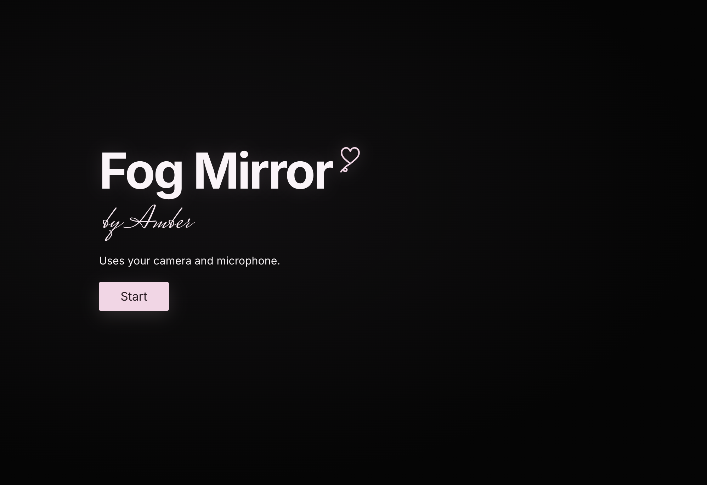

<div align="center">


# Fog Mirror

**Draw on a foggy mirror with your fingers, wipe it with your fist, and blow to fog it back up.**




</div>

## Features

| Gesture | What it does |
| --- | --- |
| **Pinch** thumb and index finger | Draw through the fog. Release to lift the pen. |
| **Fist** and sweep | Wipe away large areas of fog. |
| **Purse your lips** and blow | Fog builds around your mouth and spreads the longer you blow. |

Up to two people can draw and blow at the same time. Use the slider at the bottom to change the brush size, and the camera button in the top-right corner to save a photo.

## Getting started

You need a desktop browser (tested in Chrome and Edge), a webcam, and a microphone.

```bash
git clone https://github.com/amberouyang/fog-mirror.git
cd fog-mirror
python3 -m http.server 8000
```

Open [http://localhost:8000](http://localhost:8000), click **Start**, and allow camera and microphone access. For the best tracking, stand about an arm's length from the camera in a well-lit room.

> [!NOTE]
> Browsers only allow camera access on `localhost` or over HTTPS, so open the app through a local server rather than opening `index.html` directly.

## How it works

- **Fog:** the mirrored camera image is blurred and tinted each frame, and a density mask controls where fog appears.
- **Hands:** [MediaPipe Hand Landmarker](https://ai.google.dev/edge/mediapipe/solutions/vision/hand_landmarker) tracks finger positions to detect pinches and fists.
- **Breath:** [MediaPipe Face Landmarker](https://ai.google.dev/edge/mediapipe/solutions/vision/face_landmarker) detects pursed lips while the Web Audio API listens for a steady breath.

## Privacy

Everything runs in your browser. Camera and microphone input is never recorded or uploaded.

## Author

**Amber Ouyang** · [@amberouyang](https://github.com/amberouyang)
